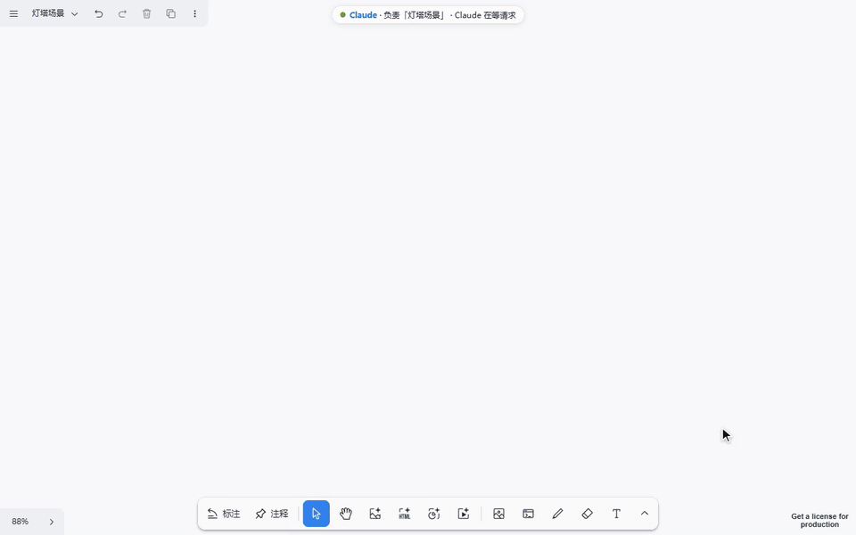

# Cowart for Claude

An AI infinite canvas built on tldraw. Lay out images, videos, web page captures and AI-made HTML / slides on one canvas, draw an arrow to the spot you want changed, and let the AI iterate.

中文：[README.md](README.md)



This is a fork of [zhongerxin/Cowart](https://github.com/zhongerxin/Cowart) (MIT). The original is a Codex plugin whose canvas is an MCP Apps widget inside the chat, one canvas per project. This fork runs **one canvas service per machine** instead, so every session in **Claude Code desktop, Codex and ZCode** shares the same canvas and splits the work by page. Upstream code is left alone as far as possible; the changes live in `adapters/`.

The canvas UI and the skill the AI reads are in Chinese; the AI answers you in whatever language you use.

## What's different from the original

| | Original | This fork |
|---|---|---|
| Hosts | Codex | Claude Code desktop, Codex, ZCode |
| Where the canvas shows | A widget in the Codex chat | A local page at `http://cowart.localhost`: Claude Code's Browser panel, Codex's built-in browser, or any browser |
| How the AI works the canvas | MCP tools | A `cowart` command (Claude Code, Codex; no MCP); ZCode goes through a thin MCP bridge |
| Canvas data | One per project (`<project>/canvas`) | One per machine (`~/.cowart/canvas`), shared by every project and session, split by page |
| Image generation | Through the chat, by Codex | Pick the model and settings in the panel and hit send: the canvas service generates the image / video itself, no chat round trip |

New:

- **Pages with owners**: each page belongs to one session at a time, and requests sent from the canvas go to the session that owns that page. Several open canvas tabs only save their changes, so they never overwrite each other or delete someone else's page.
- **Resident canvas service**: one per machine, started at Windows sign-in, not tied to any session or host. A newer version replaces the running one without dropping open canvases.
- **AI video, web references, video frames**: the bottom toolbar gains "AI video" (placeholder + generation panel) and "Web" (a full-page capture card that can be turned into HTML); right-click a video to save the current frame.
- **AI image panel**: model, aspect ratio and settings in one panel that says whether it costs money; generated images keep their own proportions instead of being stretched.
- **Annotations bound to cards**: an annotation arrow is pinned to the card it points at, follows it when it moves and goes when it is deleted. New: blue "notes" (standing instructions) and "clear annotations".
- **Page folders**: the page menu becomes a folder tree with search, sorted by creation, name or last change; the AI files pages into folders.
- **AI tidies the canvas**: add text, group into frames, move, resize, delete.
- **Context menu**: "Copy reference" (page, shape id and local file path, ready to paste to the AI) and "Show in Explorer".
- **Feedback inbox**: say "feedback: …" in a session in any project; it is filed on the machine and handled back in this repo.

Upstream bugs fixed along the way: piles of leftover `.tmp` files when a write fails on Windows; Ctrl+Z after deleting an image brings back its annotations but not the image; the 40-page cap; the context menu never opening again after dragging a card while it was open.

## Install

Needs Node ≥ 22.12. Claude Code is supported in the desktop app only (not the CLI or IDE extensions). The AI image / AI video panels need the beast generation backend (a `beast` command on the machine); without it those two panels do not work (in Codex, AI image can use Codex's built-in image generation), while the canvas, annotations, AI HTML / slides and tidying all work as usual.

```bash
git clone -c core.autocrlf=false -c core.eol=lf https://github.com/15195999826/cowart-for-claude.git
cd cowart-for-claude
npm ci --prefix adapters
```

- **Claude Code desktop (+ Codex)**: `npm --prefix adapters run install:claude`. Installs the cowart skill and the command entry `~/.cowart/bin/cowart.mjs`; on Windows also starts the canvas service at sign-in; if Codex is on the machine (`~/.codex`), also installs Codex's skill and prompt hook.
- **ZCode**: `npm --prefix adapters run install:zcode`.

Then start a new session (in Codex, a new task; it asks you once to trust the prompt hook). To uninstall: `node ~/.cowart/bin/cowart.mjs uninstall`, `npm --prefix adapters run uninstall:zcode`.

## Use

In a session, say "open the Cowart canvas" or "open the Cowart canvas <page name>":

- **Claude Code**: the canvas opens in the Browser panel on the right. Requests from the canvas (edit by annotation, AI HTML, …) wake the session through a background listener and run once you confirm.
- **Codex**: you get a link to open in the built-in browser (Ctrl+Shift+B). When a request is waiting, your next message gets a short reminder; say "check the canvas" to handle it.
- **ZCode**: you get a URL to open in any browser.

Say "take over <page name>" to move a page to the current session. AI image, AI HTML, AI slides and edit-by-annotation work on the canvas as in the original.

## Develop

Read [FORK.md](FORK.md) first (in Chinese): the ground rules (upstream as is + adapter layer), layout, host differences and the list of patch points. The adapter layer is described in [adapters/claude/README.md](adapters/claude/README.md) and [adapters/zcode/README.md](adapters/zcode/README.md).

```bash
npm --prefix adapters run check:contract   # upstream interfaces and patch points still there
npm --prefix adapters run test:claude      # end-to-end checks (Claude Code and Codex command sessions)
npm --prefix adapters run test:zcode       # ZCode bridge
npm --prefix adapters run build:artifacts  # regenerate adapters/generated/ after changing adapters/
```

After changing `src/` (the canvas page), run `npm ci && npm run build:artifacts` at the repo root to regenerate `mcp/generated/`. When you open a Claude session in the repo itself, the upstream `cowart_mcp` in the root `.mcp.json` is not used here; turn it off with `{"disabledMcpjsonServers": ["cowart_mcp"]}` in `.claude/settings.local.json`.

## License and credits

MIT. Original by ZHONG XIN ([zhongerxin/Cowart](https://github.com/zhongerxin/Cowart)); the canvas is built on [tldraw](https://github.com/tldraw/tldraw).
